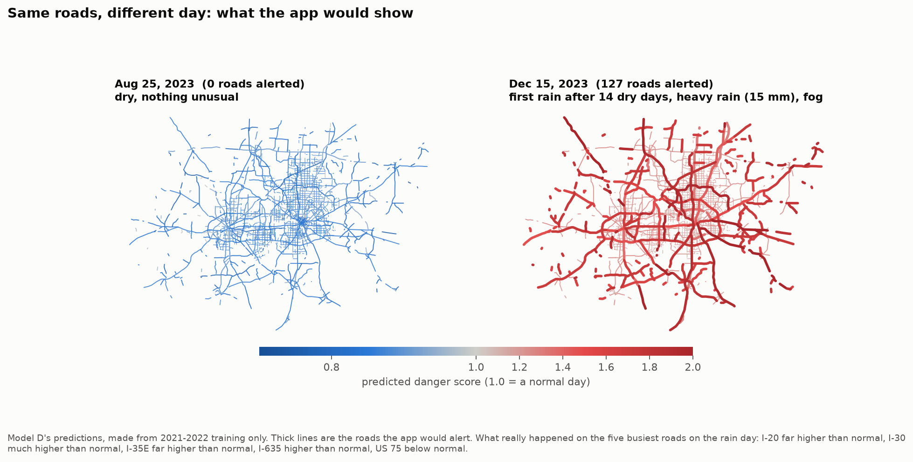
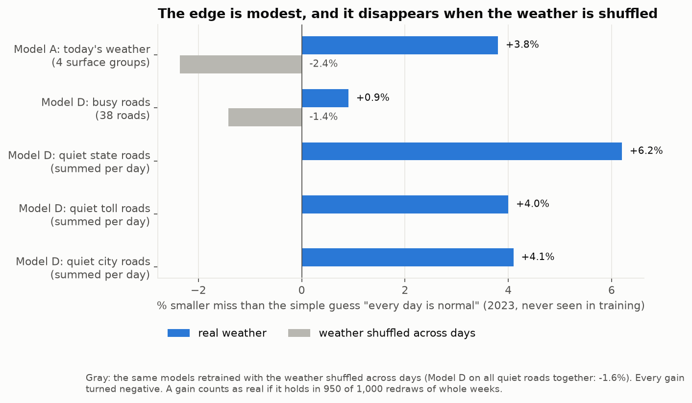
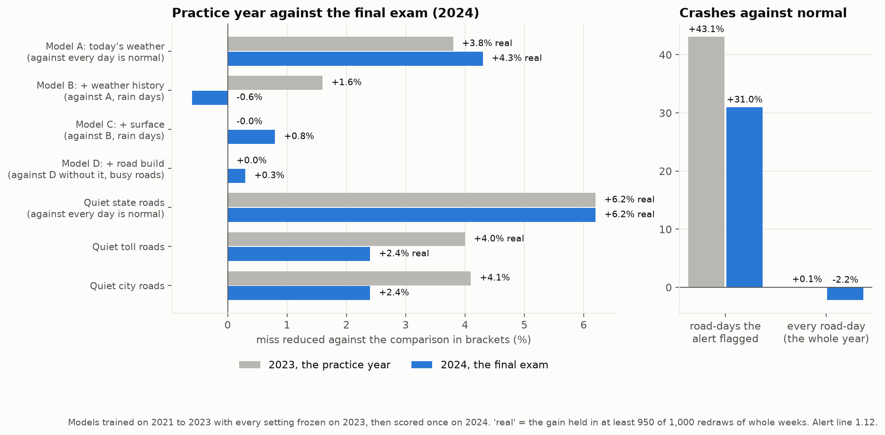

# Rosafe

*Same rain, different road.* Veritas AI International High School Hackathon 2026, **Climate track**,
team AYA.

[](https://colab.research.google.com/github/jacob-gorny/rosafe/blob/main/notebook/same_rain_different_road.ipynb)

Each day, our model gives **855 Dallas-Fort Worth roads** (state highways, toll roads and the busiest city streets) a
**danger score**: predicted crashes divided by that road's normal day. 1.0 is normal; 1.4 means 40% more crashes than
usual. Its inputs are the day's weather, the weeks of weather before it, and how each road is built; the tests below
show which of those actually help. An iPhone app runs in the background and, on days with rain or ice, chimes when you
drive toward a road that is among the riskiest that day. For now it replays past days (a day picker makes a 2023 or
2024 day "today"); a live mode needs a weather forecast feed. You
decide: slow down, leave earlier, or pick a road that isn't flagged.

**See the scores without installing anything:** download [`docs/demo/index.html`](docs/demo/index.html) (on GitHub,
open it and choose "Download raw file") and open it in a browser. It's an offline map of the scores of the 850 roads
that have a map shape, day by day. It shows the model's output files; it is not the app.



## The four questions

| | |
|---|---|
| **Who is it for?** | A DFW driver on a rainy day, deciding whether to slow down, leave earlier or pick another road. |
| **What goes in, what comes out?** | In: NOAA's daily weather at DFW Airport (that day and the weeks before) and each road's build. Out: a predicted score for every road, every day, and, on days with rain or ice, the list of roads the app warns about. |
| **Does it beat a simple guess?** | Yes, modestly, on 2024, a year it never saw: Model A beat the bar by 4.3% and Model D beat it road by road on the busy roads by 1.0%, both real, and the day's weather beyond rain added a real gain over a one-line rain rule. In the 2023 practice year, yes, modestly, and mostly because of rain. The bar is "every day is normal", which beat "tomorrow equals today" in both years. |
| **Where does it fail?** | In 2024: the dry day after the January freeze, when ice was probably still on the roads (it predicted too low, and the app stayed quiet), a heavy storm and a day of light rain and fog (too low), and two other heavy storms (too high). In 2023: ice days (too rare to learn well), a first rain after a long dry spell (it predicted too low), and the year's heaviest downpour (it predicted too high). See "Where it fails". |

## Results

Models trained on 2021 to 2022 and every choice was made on 2023, the practice year. Then everything was frozen,
retrained on 2021 to 2023, and **run once on 2024**. A gain counts as real if it held in at least 950 of 1,000 redraws
of the test year built from randomly picked whole weeks; "could be luck" means it didn't. "The bar" is the simple
guess "every day is normal" (a score of 1.0 for every road).

| Question | 2024 final | 2023 practice |
|---|---|---|
| Which simple guess is the bar? (Test 1) | "every day is normal" again: miss 0.235 on the surface groups, against 0.325 for "tomorrow equals today" | "every day is normal": miss 0.237 on the surface groups, against 0.329 for "tomorrow equals today" |
| Does today's weather beat the bar? (Model A, four DFW-wide surface groups) | **+4.3%**, real (972/1000) | **+3.8%**, real (997/1000) |
| Is that more than "did it rain"? (a one-line rain rule; Model A against it) | the rain rule alone: +0.9%, could be luck (773); Model A over it: +3.5%, real (982) | the rain rule alone: +3.0%, real (998); Model A over it: +0.9%, could be luck (802) |
| Model A knowing only yesterday's weather (a stand-in for a forecast) | not rerun | +0.4%, could be luck (723/1000): without today's weather the edge almost vanishes |
| Does the weather history add to Model A? (Model B, rain days) | -0.6%, no gain (350/1000) | +1.6%, could be luck (880/1000) |
| Does road surface add to Model B? (Model C, rain days) | +0.8%, could be luck (685/1000) | 0.0% (517/1000) |
| Does road build add, road by road? (Model D against the same model without it, 35 busy state stretches) | +0.3% (948/1000, just short) | 0.0% (573/1000) |
| Model D against the bar, road by road (38 busy roads) | +1.0%, real (953/1000); beats the bar on 8 of the 10 busiest (pass line 7: passed) | +0.9%, real (989/1000); beats the bar on 6 of the 10 busiest (pass line 7: failed) |
| Does it rank which busy roads get worst in rain? (rank correlation, 0 random, 1 perfect) | **+0.52**, real (1000/1000) | **+0.45**, real (1000/1000) |
| ...better than each road's earlier rain-day record? | that record alone: +0.47; the model is higher in 772/1000, could be luck | that record alone: +0.47; the model is higher in only 385/1000 |
| Quiet roads summed by layer (state, toll, city), against the bar | +6.2% real, +2.4% real, +2.4% (709/1000, could be luck) | +6.2% real, +4.0% real, +4.1% (939/1000, just short) |
| Is the alert worth having, as planned? (Test 6: right more often than "warn every rain day" and catching as many bad days) | no: right 18.0% vs 13.3%, but catches 29.3% vs 39.0% | no: right 21.9% vs 16.4%, but catches 21.8% vs 32.2% |
| **Road-days flagged by the app's alert, against normal** (rule chosen on 2023; rain or ice days only) | **+31.0%**, 7,772 road-days on 79 days (warn on every road whenever it rains: +8.2%; every road-day of the year: -2.2%) | **+43.1%**, 5,606 road-days on 55 days (warn on every road whenever it rains: +16.8%; every road-day of the year: +0.1%) |
| ...on the busy roads: how often it's right, and the share of bad days it catches | right 20.9%, catches 23.2% (warn every rain day: 13.3% and 39.0%) | right 25.7%, catches 17.3% (warn every rain day: 16.4% and 32.2%) |
| Shuffle the weather across days: does the edge vanish? (Test 9) | yes (-0.8% for Model A) | yes (-2.4% for Model A) |
| Did we tune too hard on 2023? (Test 10: 2024's Model A gain at least half of 2023's) | no: +4.3% against +3.8% on 2023 (passed) | n/a |





**The three research claims**, written down before any crash-versus-weather result (a cold audit before 2024 made the
tests for claims 2 and 3 stricter; `docs/audit-2023.md` shows old and new):

| Claim | 2021 to 2024 | 2024 alone |
|---|---|---|
| 1. First rain after 7+ dry days brings a bigger jump than rain the day after rain | did not hold, 852/1000 (2021 to 2023: did not hold, 821/1000) | did not hold, 679/1000 |
| 2. On the six roads with both surfaces, the first-rain jump differs between asphalt over concrete and concrete | held, asphalt over concrete jumps more, 1000/1000 (2021 to 2023: held, asphalt over concrete jumps more, 1000/1000) | did not hold, 875/1000 |
| 3. Summer rain after a hot spell is worse on asphalt-topped roads (asphalt, asphalt over concrete, seal coat) than on concrete | did not hold, 810/1000 (2021 to 2023: did not hold, 778/1000) | did not hold, 594/1000 |

**Where it fails.** The 5 worst days of 2024, as the 38 busy roads' combined score for the day: May 12, heavy rain
with thunder and fog (predicted 1.46, real 2.18); Dec 8, light rain with fog (1.19 against 1.83); two heavy storms it
called too high, Jun 2 (1.43 against 0.87) and May 30 (1.59 against 1.08), when probably fewer people drove, which we
can't check without daily traffic counts; and Jan 17, a dry day after the mid-January freeze (0.66 against 1.22), the
one we explain. Jan 15 was an ice day (1.8 mm, a low of 11 F). The app may alert on ice days, but the model predicted
fewer crashes than normal, so no road passed the alert line, and all 5 busiest roads did run below normal (the freeze
probably kept people home). Jan 16 (dry, a low of 12 F) was quiet too. On Jan 17 (dry, a low of 16 F, a high of 44 F),
I-30, I-635 and US 75 ran much higher than normal, probably because people went back out while ice was still on the
roads. A dry day in the daily weather record shows none of that: the model predicted fewer crashes than normal, no
road reached the alert line, and the app stayed quiet. This is the honest limit: leftover ice after a freeze. The same pattern hit Feb 3, 2023.

In 2023, as the 38 busy roads' combined score for the day: an ice day (Jan 30: predicted 1.59, real 2.83), a first
rain after 35 dry days (Jan 24: 1.22 against 2.10), and the year's heaviest downpour, which it called too high (Oct 25:
1.88 against 1.21; probably fewer people drove, which we can't check without daily traffic counts, and it was the third
heavy-rain day in a row). Two more were fog days: Feb 3, the morning after a four-day ice storm, so leftover ice may
explain it better than fog, and Nov 30, light rain with heavy fog.

**The honest size.** A few percent better than "every day is normal". Crashes are partly luck, but that isn't the whole
gap: in the 2023 practice year, on the surface groups, even a perfect model would still miss about 0.18 (the notebook's
"chance floor", printed next to the misses of the bar and Models A to C), against 0.237 for the bar and 0.228 for Model
A, so better inputs (hourly or local weather) still have room. The useful part is *which* roads on *which* days.

## How it works, in four lines

1. **Data:** every crash in the 12 DFW counties, 2020 to 2024 (679,621, from TxDOT), and NOAA's daily weather at DFW Airport (37 columns: 36 built from it, including weather history, plus a holiday flag for US federal holidays and the day after Thanksgiving).
2. **Score:** for each road and day, crashes divided by that road's normal for that weekday; on every test day the normal uses only earlier days.
3. **Models:** ridge regression on the four road-surface groups (A, B, C), then gradient boosting that scores every road one by one (D).
4. **Tests:** every model against simple guesses, 1,000 week redraws for "real, not luck", a shuffled-weather check, and 2024 held out until the end.

## Run it

**The notebook's outputs are saved,** so every result can be read here on GitHub without running anything. To rerun
it, use a laptop (below): a fresh clone of this repo ran top to bottom on ours in 3.5 minutes, downloads included,
and printed exactly the saved outputs. It peaked at about 10.7 GB of memory, so a
machine with 16 GB is safest. It downloads TxDOT's crash file and
NOAA's weather itself, needs no API key, and reruns the 2024 final exam because `notebook/OPEN_2024.flag` is committed.

**Google Colab's free machine isn't enough.** We tried Run all there on Nov 15: with Colab's library versions
(pandas 2.2.3, scikit-learn 1.6.1) the notebook peaks at about 12.4 GB of memory, and the run stopped at Step 10
(Model D, road by road), most likely out of memory. The badge above still opens the notebook to read. A Colab
runtime with more memory should get through it, but we haven't tested one.

**On a Mac or Linux** (needs Python 3.12: check with `python3 --version`; on Windows, type `python` instead of `python3` and `.venv\Scripts\` instead of `.venv/bin/`). Clone the repo rather than downloading the ZIP, because one test uses git:
```bash
git clone https://github.com/jacob-gorny/rosafe.git
cd rosafe/notebook
python3 -m venv .venv && .venv/bin/pip install -r requirements-dev.txt
.venv/bin/jupyter nbconvert --to notebook --execute --inplace same_rain_different_road.ipynb
.venv/bin/python -m pytest tests -q
```
`requirements.txt` pins the library versions behind the saved outputs. Other versions run fine, but scikit-learn's
gradient boosting can shift Model D's numbers slightly (with scikit-learn 1.6.1, checked on 2023 before 2024 was opened, no verdict changed).

## What's where

- `notebook/`: the model. `same_rain_different_road.ipynb` (and the same notebook as a `.py` file), the crash download
  script, the decision-model client (an optional road-chemistry layer that needs an API key; it did not run, so Model
  D is the model), the viewer builder, and `tests/`.
- `data/`: the small files the notebook writes and the app reads (format: `docs/app-data-contract.md`). **No raw crash rows.**
- `app/`: the iPhone app (SwiftUI, an Xcode project; see `app/README.md`).
- `docs/`: figures, the offline viewer (`demo/`), the audit (`audit-2023.md`), hand checks, the brain-to-app
  handoffs and data contract, and the records of the alert-rule decision (`proposals/`).
- `CLAUDE.md`: the full project log, decisions and rules.

## Data and privacy

- **Crashes:** Texas Department of Transportation, Crash Records Information System (CRIS), 2020 to 2024, accessed
  Nov 14, 2026 through TxDOT's public map layer ["TXDOT Statewide Bicyclist Involved Crashes"](https://services.arcgis.com/KTcxiTD9dsQw4r7Z/arcgis/rest/services/TXDOT_Statewide_Bicyclist_Involved_Crashes/FeatureServer/0).
  Despite its title, the layer holds all crashes. We checked its yearly death counts against TxDOT's published totals.
- **TxDOT's terms don't allow passing the raw data on.** The file is never committed; the notebook downloads it when
  it runs and shows at most 5 raw rows. The app files hold rounded predicted scores, each road's build (taken from its
  crash records), map lines in which every point is the average position of at least 5 crashes, and, for the 5 busiest
  roads only, a coarse "what really happened" level.
- **Weather:** [NOAA GHCN-Daily, DFW Airport (USW00003927)](https://www.ncei.noaa.gov/data/global-historical-climatology-network-daily/access/USW00003927.csv).
- **The app:** asks before it uses location, compares it with the day's flagged roads on the phone, and never stores
  or sends it. Our code makes no network calls (the map is Apple's MapKit), and the only thing the app saves is the
  day you picked.

## Limits

- It predicts per day, not per hour.
- "Today's weather" is the whole measured day, which stands in for a perfect forecast. A live version would use the
  forecast and do worse: in 2023, with only yesterday's weather, Model A's edge fell from 3.8% to 0.4%, so a live
  version needs a good forecast of today's rain.
- The app can only replay past days until a live "today" mode with a weather forecast exists.
- One weather station covers all 12 counties; storms are local.
- It counts crashes, not danger per trip, and it compares each road only with its own normal, not with other roads.
- City streets and toll roads have no surface, lanes or traffic data from TxDOT; they're scored from road class, speed
  limit and their own crash level in the training years.
- 855 roads, not every road. Quiet roads are tested in groups, not one by one.
- The alert stays quiet on days without rain or ice. We picked that filter on 2023 from several versions (in 2023 most
  of the edge was rain, and every alert then has a weather reason to show), so the alert's 2023 numbers flatter it. In
  2024 its flagged road-days ran +31.0% above normal (2023: +43.1%), against +8.2% for warning on every road whenever
  it rains. That year the weather beyond rain added a real gain, but the rule was fixed before 2024 opened, and we
  didn't change it.
- iPhone only; judges can't install the app this weekend, so it's shown in the video, on a simulated drive.
- The app hasn't been tested in a real car yet, and its alert arriving on the lock screen and over Apple Maps was
  checked in the Simulator, not yet on a real phone.

## Credits

- **Data:** TxDOT CRIS and NOAA GHCN-Daily (above); City of Lewisville crash layer, used to decode surface codes 1,
  2, 3, 4 and 7 (codes 5, 6 and 10 follow TxDOT's standard list).
- **Research behind the claims:** UC Berkeley (rain after a dry spell, 2003); Texas A&M Transportation Institute
  (asphalt bleeding and flushing).
- **Libraries:** pandas, NumPy, scikit-learn, SciPy, matplotlib, requests, Jupyter, jupytext, pytest. The app uses
  Apple's SwiftUI, MapKit, Core Location, UserNotifications, Observation, Core Text and UIKit, the
  Archivo typeface (SIL Open Font License) and SF Symbols for its in-app symbols.
- **Filmed drive:** the drive in the video is the iOS Simulator's location simulation along a path from Apple Maps
  driving directions, made by a dev script (`app/tools/video-route.swift`) that is not part of the app; the app gets it
  as ordinary location updates.
- **AI tools:** Claude (planning chat) reviewed the idea, found and checked the data, and wrote the download script
  and the plan. Claude Code wrote most of the notebook code, the tests, the viewer and the first drafts of the docs,
  and ran the code audits and the research and fact-checking agents behind the road-chemistry background sheet
  (`docs/chemistry_sheets/`). Claude Code also built the iPhone app with us and checked our data against outside
  sources: the National Weather Service's daily record for DFW Airport (every day of 2023 and 2024 matched) and
  OpenStreetMap's road lines (14 roads, all within metres of the real road). We chose the question, made the
  decisions and can explain every step.
- **Checks:** weather against the Regional Climate Centers' Applied Climate Information System (the service behind
  the National Weather Service's NOWData, https://data.rcc-acis.org); road lines against OpenStreetMap (© OpenStreetMap contributors,
  ODbL, through the Overpass API).
